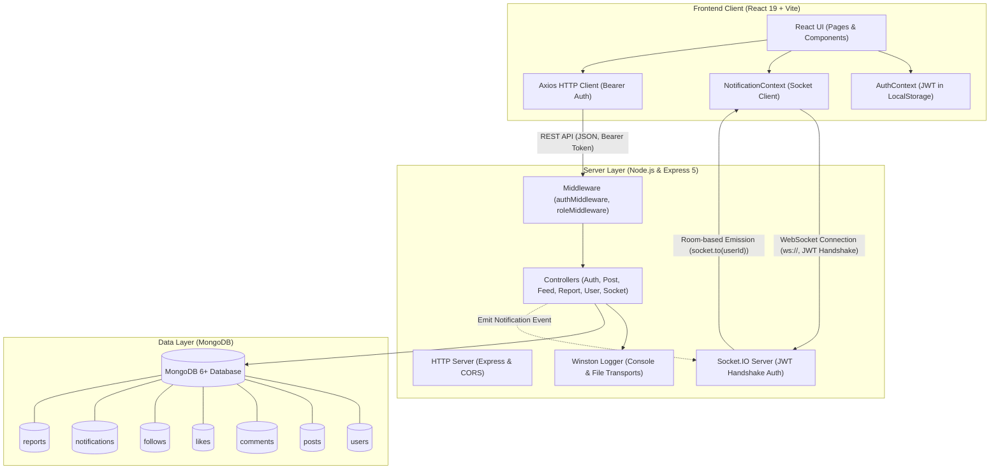
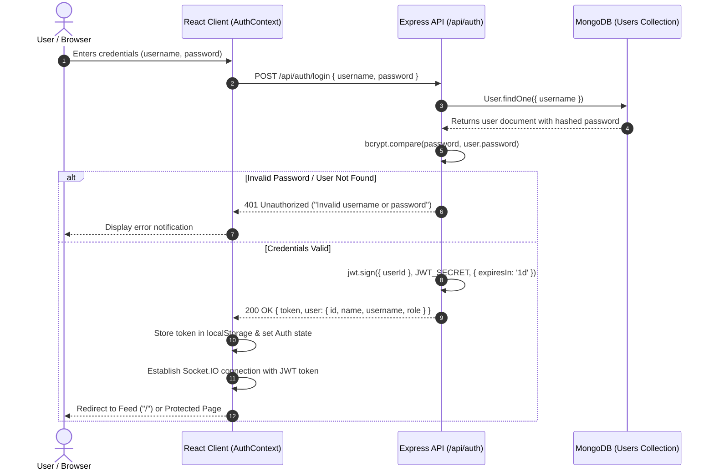
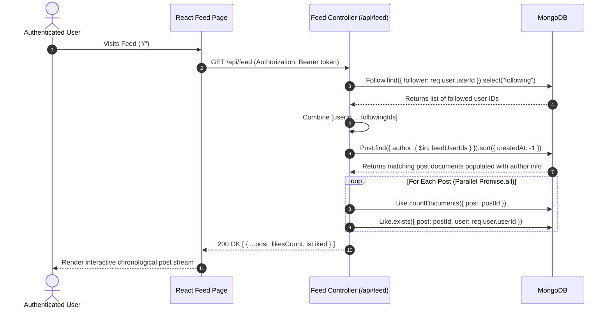
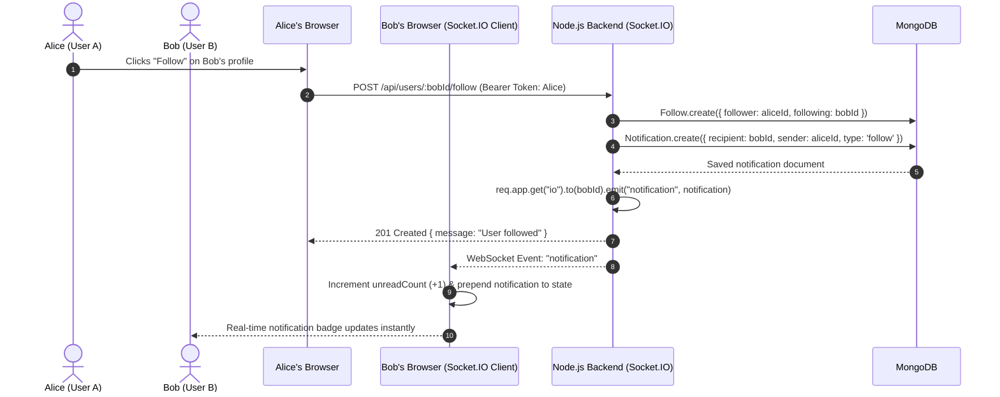
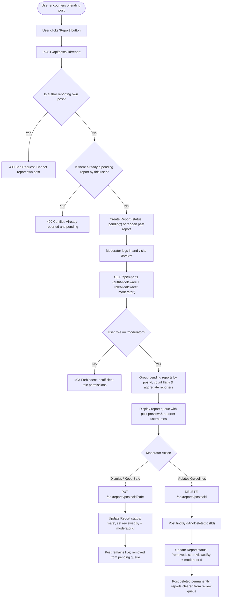
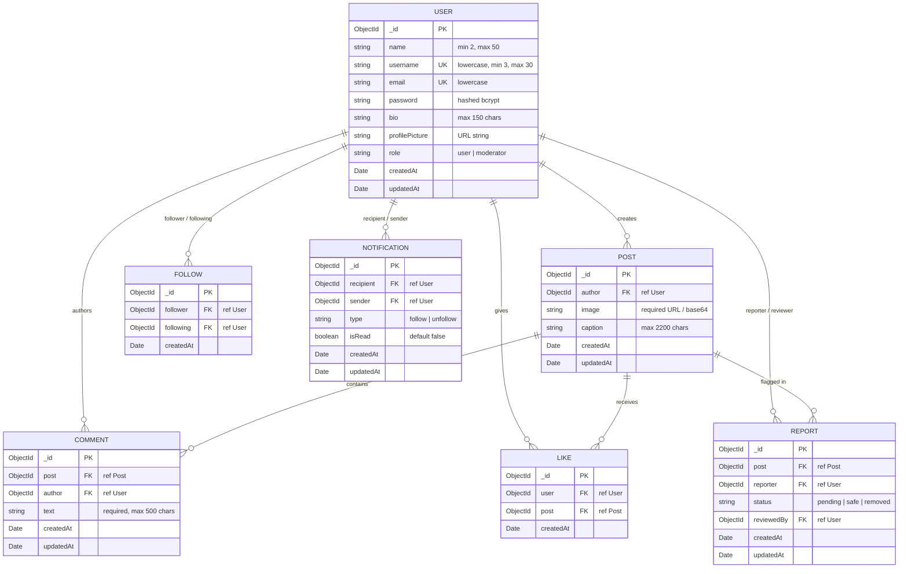

# Instagram Lite (Full-Stack Social Platform)

[](https://nodejs.org/)
[](https://expressjs.com/)
[](https://react.dev/)
[](https://vitejs.dev/)
[](https://www.mongodb.com/)
[](https://socket.io/)
[](LICENSE)

A production-ready, full-stack social media web application modeled after Instagram. Built with a modern **React 19 + Vite** frontend and an **Express.js + MongoDB (Mongoose)** backend, **Instagram Lite** features real-time notifications via **Socket.IO**, role-based access control (RBAC) with a dedicated **content moderation queue**, personalized chronological feed aggregation, unique like constraints, comment threads, and Winston-based structured audit logging.

---

## Table of Contents

- [Overview](#overview)
- [Key Features](#key-features)
- [System Architecture](#system-architecture)
- [Application Workflows](#application-workflows)
  - [1. User Authentication & Session Lifecycle](#1-user-authentication--session-lifecycle)
  - [2. Feed Aggregation & Social Graph Workflow](#2-feed-aggregation--social-graph-workflow)
  - [3. Real-Time Notification Workflow (Socket.IO)](#3-real-time-notification-workflow-socketio)
  - [4. Content Reporting & Moderator Action Workflow](#4-content-reporting--moderator-action-workflow)
- [Database Architecture & Data Models](#database-architecture--data-models)
  - [Entity Relationship Diagram (ERD)](#entity-relationship-diagram-erd)
  - [Indexing & Database Optimization](#indexing--database-optimization)
- [API Reference](#api-reference)
  - [Authentication](#authentication)
  - [Users & Profiles](#users--profiles)
  - [Posts & Feed](#posts--feed)
  - [Likes & Comments](#likes--comments)
  - [Follow System](#follow-system)
  - [Notifications](#notifications)
  - [Moderation & Reports](#moderation--reports)
- [Real-Time WebSocket Protocol](#real-time-websocket-protocol)
- [Project Directory Structure](#project-directory-structure)
- [Getting Started & Local Setup](#getting-started--local-setup)
  - [Prerequisites](#prerequisites)
  - [1. Clone Repository](#1-clone-repository)
  - [2. Backend Setup](#2-backend-setup)
  - [3. Frontend Setup](#3-frontend-setup)
  - [4. Running the Application](#4-running-the-application)
- [Testing User vs Moderator Roles](#testing-user-vs-moderator-roles)
- [License](#license)

---

## Overview

Instagram Lite demonstrates real-world software engineering practices for social networks:
- **Clean RESTful API Architecture**: Modular routes, controllers, models, and middleware.
- **Relational Integrity in NoSQL**: Compound unique indexes in MongoDB to prevent duplicate likes, double-following, or duplicate pending reports.
- **Real-Time Push Communication**: WebSockets integrated with JWT handshake authentication to stream notifications immediately without client polling.
- **Role-Based Access Control (RBAC)**: Distinguishes between standard `user` accounts and `moderator` accounts with protected moderation queues.
- **Enterprise-Grade Logging**: Winston-powered structured logging capturing request metadata, security warnings, and error stacks to both console and log files (`logs/error.log`, `logs/combined.log`).

---

## Key Features

| Category | Capability | Details |
| :--- | :--- | :--- |
| **Authentication** | Secure Auth & RBAC | Password hashing with `bcryptjs` (salt rounds: 10), JWT issued on login, protected route middleware, and role checks (`user`, `moderator`). |
| **Social Graph** | Follow / Unfollow | Self-follow prevention, follower/following count lookups, and compound index enforcement. |
| **Posts & Media** | Post Management | Create posts with image URLs & captions, edit captions (author-only), and delete posts. |
| **Engagement** | Likes & Comments | Unique post liking (no duplicate likes), like counter, chronological comment threads with author details. |
| **Personalized Feed** | Dynamic Feed Engine | Generates a chronological stream combining posts from followed accounts and the user's own posts with hydrated like states. |
| **Real-Time System** | Instant Notifications | Socket.IO room-per-user design push alerts when followed or unfollowed, with unread badge count and mark-as-read API. |
| **Moderation Engine** | Reporting & Review | Users can flag inappropriate posts; moderators get a dedicated `/review` dashboard to group reports, inspect content, mark safe, or delete offending posts. |
| **User Search & Profile** | Discovery & Stats | Case-insensitive regex user search, full profile stats (post count, follower/following counts, follow status toggle). |

---

## System Architecture



---

## Application Workflows

### 1. User Authentication & Session Lifecycle



---

### 2. Feed Aggregation & Social Graph Workflow



---

### 3. Real-Time Notification Workflow (Socket.IO)



---

### 4. Content Reporting & Moderator Action Workflow



---

## Database Architecture & Data Models

### Entity Relationship Diagram (ERD)



---

### Indexing & Database Optimization

Strategic indexes enforce uniqueness and deliver fast read/write speeds even under heavy loads:

| Collection | Indexed Fields | Index Type | Constraint / Purpose |
| :--- | :--- | :--- | :--- |
| **`users`** | `username` | Single Field | `unique: true` — Fast lookup for authentication and profile routes. |
| **`users`** | `email` | Single Field | `unique: true` — Guarantees unique email per registered user. |
| **`posts`** | `{ author: 1, createdAt: -1 }` | Compound | Fast retrieval of user profile post history sorted chronologically. |
| **`comments`** | `{ post: 1, createdAt: -1 }` | Compound | Fast fetch of comments under any post in reverse chronological order. |
| **`likes`** | `{ user: 1, post: 1 }` | Compound Unique | `unique: true` — Prevents race condition double-likes from the same user. |
| **`follows`** | `{ follower: 1, following: 1 }` | Compound Unique | `unique: true` — Prevents duplicate follow relationships. |
| **`follows`** | `following` | Secondary Index | Enables high-performance lookups for *"Who follows user X?"*. |
| **`notifications`** | `{ recipient: 1, createdAt: -1 }` | Compound | Fast pagination and sorting of notifications for recipient. |
| **`notifications`** | `{ recipient: 1, isRead: 1 }` | Compound | Fast aggregation of unread notification counter badge. |
| **`reports`** | `{ reporter: 1, post: 1 }` | Compound Unique | `unique: true` — Restricts user to a single active report per post. |
| **`reports`** | `{ status: 1, post: 1 }` | Compound | Ultra-fast grouping and querying of pending moderation queue items. |

---

## API Reference

Base URL: `http://localhost:5000` (or `http://localhost:5000/api`)

### Authentication

| Method | Endpoint | Auth Required | Role | Description |
| :--- | :--- | :---: | :---: | :--- |
| `POST` | `/api/auth/register` | No | Any | Register user (`name`, `username`, `email`, `password`, `bio`, `profilePicture`). |
| `POST` | `/api/auth/login` | No | Any | Authenticate with `username` and `password`. Returns JWT token. |

---

### Users & Profiles

| Method | Endpoint | Auth Required | Role | Description |
| :--- | :--- | :---: | :---: | :--- |
| `GET` | `/api/users/search?q=:query` | Yes | Any | Search users by name or username (case-insensitive regex, max 20). |
| `GET` | `/api/users/:id` | Yes | Any | Get user profile details, posts, counts (posts, followers, following), and `isFollowing`. |
| `PUT` | `/api/users/:id` | Yes | Owner | Update user's own profile (`name`, `bio`, `profilePicture`). |

---

### Posts & Feed

| Method | Endpoint | Auth Required | Role | Description |
| :--- | :--- | :---: | :---: | :--- |
| `GET` | `/api/feed` | Yes | Any | Get chronological feed containing posts by followed users and logged-in user. |
| `POST` | `/api/posts` | Yes | Any | Create a new post with `image` (URL / data) and `caption`. |
| `GET` | `/api/posts/:id` | Yes | Any | Get single post details with author information, likes count, and `isLiked` state. |
| `PUT` | `/api/posts/:id` | Yes | Author | Update post `caption` (must be the post author). |
| `DELETE` | `/api/posts/:id` | Yes | Author | Delete post (must be the post author). |

---

### Likes & Comments

| Method | Endpoint | Auth Required | Role | Description |
| :--- | :--- | :---: | :---: | :--- |
| `POST` | `/api/posts/:id/like` | Yes | Any | Like a post (enforces unique like constraint). |
| `DELETE` | `/api/posts/:id/like` | Yes | Any | Unlike a post. |
| `POST` | `/api/posts/:id/comments` | Yes | Any | Add a comment to a post (`text`). |
| `GET` | `/api/posts/:id/comments` | Yes | Any | Fetch all comments for a post sorted chronologically. |
| `DELETE` | `/api/comments/:id` | Yes | Author | Delete comment (must be the comment author). |

---

### Follow System

| Method | Endpoint | Auth Required | Role | Description |
| :--- | :--- | :---: | :---: | :--- |
| `POST` | `/api/users/:id/follow` | Yes | Any | Follow a user. Triggers real-time notification to the target user. |
| `DELETE` | `/api/users/:id/follow` | Yes | Any | Unfollow a user. Emits real-time unfollow event. |

---

### Notifications

| Method | Endpoint | Auth Required | Role | Description |
| :--- | :--- | :---: | :---: | :--- |
| `GET` | `/api/notifications` | Yes | Any | Get user's notifications (up to 50) and `unreadCount`. |
| `PUT` | `/api/notifications/read` | Yes | Any | Mark all unread notifications as read. |

---

### Moderation & Reports

| Method | Endpoint | Auth Required | Role | Description |
| :--- | :--- | :---: | :---: | :--- |
| `POST` | `/api/posts/:id/report` | Yes | Any | Report an offending post (author cannot report own post). |
| `GET` | `/api/reports` | Yes | `moderator` | Fetch all pending reported posts grouped by post with report count and reporters. |
| `PUT` | `/api/reports/posts/:postId/safe` | Yes | `moderator` | Dismiss reports and mark post status as safe. |
| `DELETE` | `/api/reports/posts/:postId` | Yes | `moderator` | Remove post from platform and mark reports as removed. |

---

## Real-Time WebSocket Protocol

The application leverages **Socket.IO** with a private room architecture:

```javascript
io.use((socket, next) => {
  try {
    const token = socket.handshake.auth.token;
    const decoded = jwt.verify(token, process.env.JWT_SECRET);
    socket.userId = decoded.userId;
    next();
  } catch (err) {
    next(new Error("Invalid or expired token"));
  }
});

io.on("connection", (socket) => {
  socket.join(socket.userId);
});
```

When an event occurs (such as Alice following Bob):
1. Express controller triggers `notifyUser(req, "follow", recipientId)`.
2. Server emits to the specific room: `io.to(String(recipientId)).emit("notification", notification)`.
3. Client `NotificationContext` receives the payload, increments the notification bell counter, and updates the UI without page reload.

---

## Project Directory Structure

```bash
Instagram lite V4/
└── Instagram lite/
    ├── controllers/
    │   ├── authController.js
    │   ├── commentController.js
    │   ├── feedController.js
    │   ├── followController.js
    │   ├── notificationController.js
    │   ├── postController.js
    │   ├── reportController.js
    │   └── userController.js
    ├── middleware/
    │   ├── authMiddleware.js
    │   └── roleMiddleware.js
    ├── models/
    │   ├── Comment.js
    │   ├── Follow.js
    │   ├── Like.js
    │   ├── Notification.js
    │   ├── Post.js
    │   ├── Report.js
    │   └── User.js
    ├── routes/
    │   ├── authRoutes.js
    │   ├── commentRoutes.js
    │   ├── feedRoutes.js
    │   ├── followRoutes.js
    │   ├── notificationRoutes.js
    │   ├── postRoutes.js
    │   ├── reportRoutes.js
    │   └── userRoutes.js
    ├── utils/
    │   └── logger.js
    ├── logs/
    │   ├── combined.log
    │   └── error.log
    ├── client/
    │   ├── src/
    │   │   ├── api/
    │   │   │   ├── auth.js
    │   │   │   ├── client.js
    │   │   │   ├── feed.js
    │   │   │   ├── notifications.js
    │   │   │   ├── posts.js
    │   │   │   ├── reports.js
    │   │   │   └── users.js
    │   │   ├── components/
    │   │   │   ├── Avatar.jsx
    │   │   │   ├── CommentSection.jsx
    │   │   │   ├── Navbar.jsx
    │   │   │   ├── NotificationBell.jsx
    │   │   │   ├── PostCard.jsx
    │   │   │   ├── ProtectedRoute.jsx
    │   │   │   └── ReportButton.jsx
    │   │   ├── context/
    │   │   │   ├── AuthContext.jsx
    │   │   │   └── NotificationContext.jsx
    │   │   ├── pages/
    │   │   │   ├── CreatePost.jsx
    │   │   │   ├── EditProfile.jsx
    │   │   │   ├── Feed.jsx
    │   │   │   ├── Login.jsx
    │   │   │   ├── PostView.jsx
    │   │   │   ├── Profile.jsx
    │   │   │   ├── Register.jsx
    │   │   │   ├── Review.jsx
    │   │   │   └── Search.jsx
    │   │   ├── App.jsx
    │   │   ├── index.css
    │   │   └── main.jsx
    │   ├── .env
    │   ├── package.json
    │   └── vite.config.js
    ├── .env
    ├── app.js
    ├── db.js
    ├── package.json
    ├── server.js
    └── socket.js
```

---

## Getting Started & Local Setup

### Prerequisites

- Node.js (v18.0.0 or higher)
- MongoDB Community Server running locally on port `27017` (or MongoDB Atlas connection URI).
- Git installed on your system.

---

### 1. Clone Repository

```bash
git clone https://github.com/namaysingh3925/instagram-lite.git
cd instagram-lite
```

---

### 2. Backend Setup

1. Navigate to the backend directory:
   ```bash
   cd "Instagram lite V4/Instagram lite"
   ```

2. Install backend dependencies:
   ```bash
   npm install
   ```

3. Configure Environment Variables (`.env`):
   ```env
   PORT=5000
   MONGO_URI=mongodb://127.0.0.1:27017/instagram_lite
   JWT_SECRET=your_super_secret_jwt_key_here
   LOG_LEVEL=info
   ```

4. Ensure MongoDB is running:
   ```bash
   net start MongoDB
   ```

5. Start the backend server:
   ```bash
   npm run dev
   ```

---

### 3. Frontend Setup

1. Open a new terminal window and navigate to the client folder:
   ```bash
   cd "Instagram lite V4/Instagram lite/client"
   ```

2. Install frontend dependencies:
   ```bash
   npm install
   ```

3. Configure Environment Variables (`client/.env`):
   ```env
   VITE_API_BASE_URL=http://localhost:5000/api
   ```

4. Launch the Vite development server:
   ```bash
   npm run dev
   ```

---

### 4. Running the Application

Open your browser and navigate to:
```
http://localhost:5173
```

Features available:
1. Register a new account at `/register`.
2. Log in at `/login`.
3. Create a post at `/create`.
4. Search users and follow them at `/search`.
5. View personalized feed at `/`.

---

## Testing User vs Moderator Roles

Instagram Lite includes role-based access control out of the box.

### Default Role: `user`
Every newly registered user is assigned `role: "user"` by default:
- Can post, like, comment, follow, search, and report offending posts.
- Does not have access to `/review` (blocked by `roleMiddleware.js` and protected React routing).

### Promoting a User to `moderator`
To test the moderation workflow, promote an existing user to `moderator` in MongoDB:

```bash
mongosh
use instagram_lite
db.users.updateOne(
  { username: "your_username" },
  { $set: { role: "moderator" } }
);
```

### Accessing the Moderation Queue
1. Log in with the promoted moderator account.
2. The navbar will display the **Review** navigation link.
3. Visit `http://localhost:5173/review`.
4. Inspect reported posts, review flags, and choose to **Mark as Safe** or **Delete Post**.

---

## License

This project is licensed under the [MIT License](LICENSE).

---

## Author

**Namay Singh**  
- GitHub: [@namaysingh3925](https://github.com/namaysingh3925)
- Repository: [instagram-lite](https://github.com/namaysingh3925/instagram-lite)
